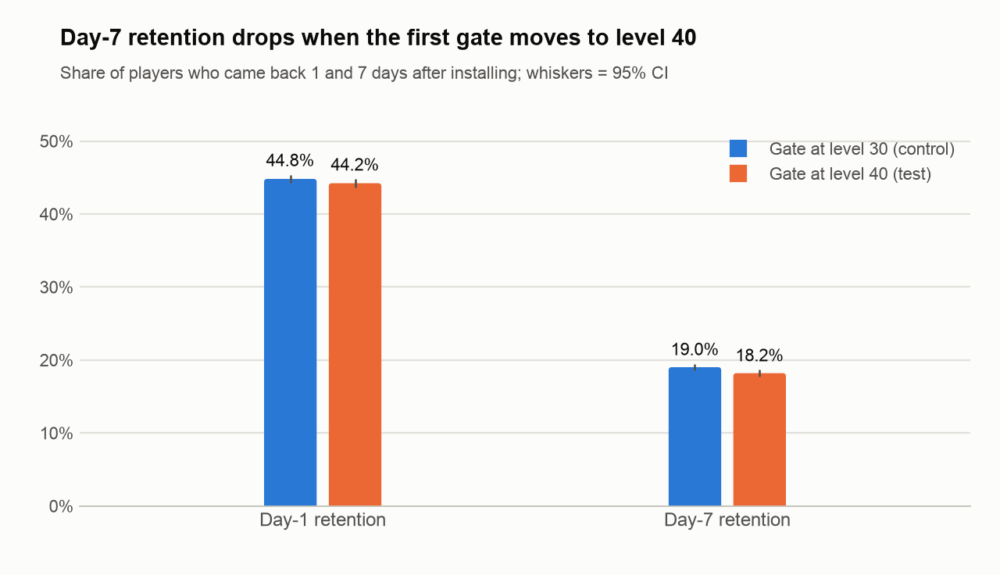
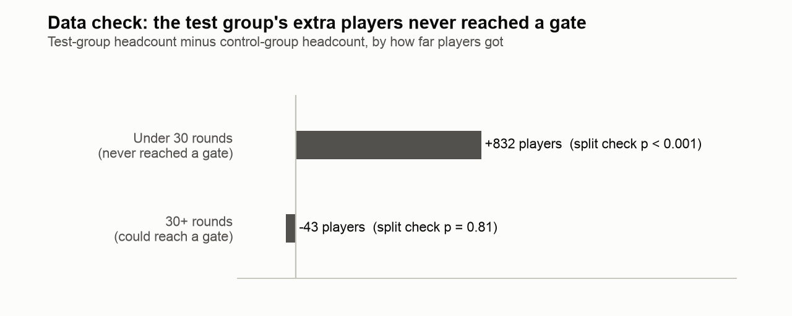
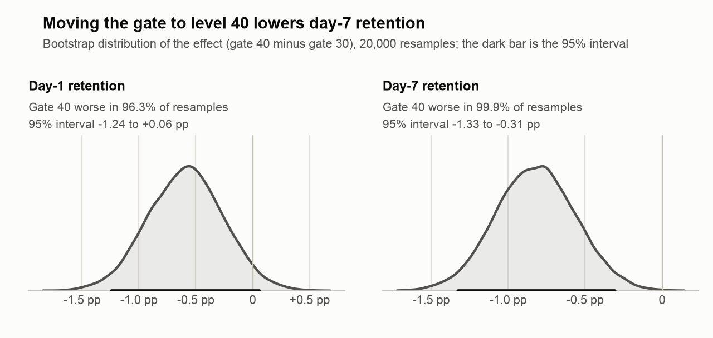
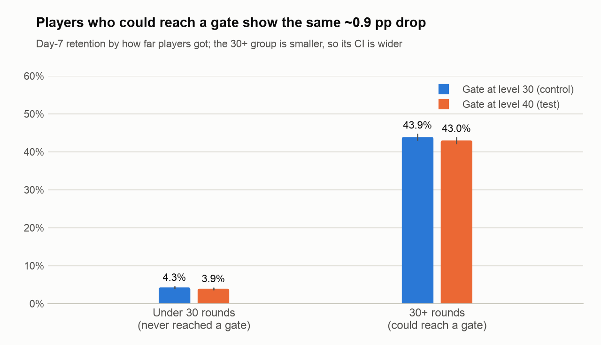
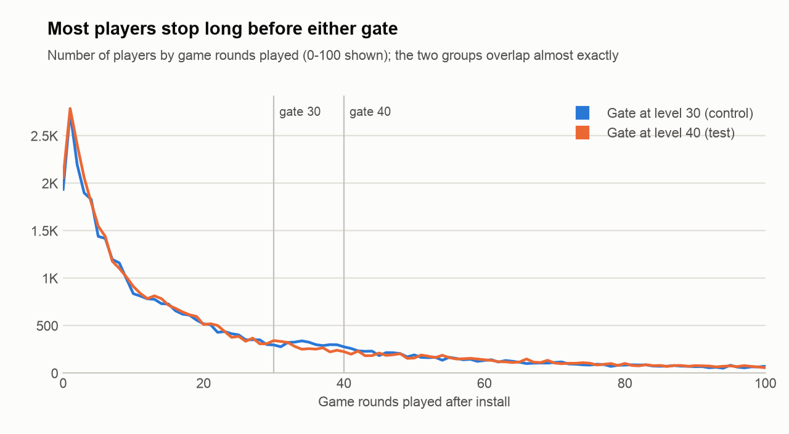
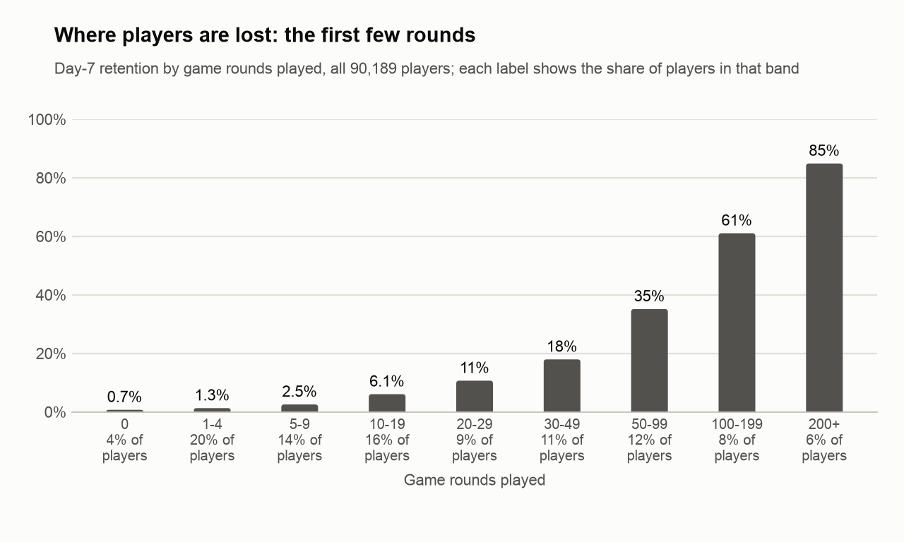

# Cookie Cats A/B test: should the first gate stay at level 30?

**Decision: keep the gate at level 30.** Moving it to level 40 lowered day-7 retention from 19.02% to 18.20%
(−0.82 percentage points, p = 0.002), and nothing in the data shows an upside. Before treating the *size* of that
effect as final, I would fix the uneven group split that the data check below turned up.

**The bigger lever sits earlier than any gate:** a quarter of players play 4 rounds or fewer, and their day-7
retention is about 1%. That is where I would run the next experiment.

| | Gate at level 30 (control) | Gate at level 40 (test) | Effect (40 − 30) | 95% CI | p |
|---|---|---|---|---|---|
| Day-7 retention | 19.02% | 18.20% | **−0.82 pp** (−4.3% relative) | −1.33 to −0.31 pp | 0.002 |
| Day-1 retention | 44.82% | 44.23% | −0.59 pp | −1.24 to +0.06 pp | 0.074 |
| Median game rounds | 17 | 16 | −1 round | | 0.050 (Mann-Whitney) |
| Players | 44,700 | 45,489 | +789 | | 0.009 (split check) |



## The question

Cookie Cats is a mobile puzzle game by Tactile Games. As players progress they reach **gates**: points where they
have to wait a while, or make an in-app purchase, before they can keep playing. The test asked whether moving the
first gate from level 30 to level 40 changes how many players come back.

The dataset covers 90,189 players who installed the game during the test. Each player was assigned to one of the
two versions and has three outcomes: game rounds played, and whether they came back 1 day and 7 days after
installing.

**Decision metric:** day-7 retention. A gate is a long-term design choice, and day 7 says more about whether
players stay than day 1. Day-1 retention and game rounds are supporting metrics.

## Before trusting the result: the data check

My background is data validation, so the first step was to check the data rather than the outcome:

- **Clean records:** every player appears once, and there are no missing values.
- **One extreme player:** a single control player logged 49,854 rounds (the next highest is 2,961). With that
  player removed, mean rounds are almost identical (51.34 vs 51.30), so I used medians and a rank test for engagement.
- **Uneven split:** the test group has 789 more players than the control group (50.44% vs an expected 50%). A
  chi-square test says a gap this large happens by chance less than 1% of the time (p = 0.009). In A/B testing this
  is called a **sample ratio mismatch**, and it usually means something went wrong in assignment or logging.

To see where the extra players came from, I split players by how far they got. **63% of players stopped before
30 game rounds**, so they never reached either gate (a game round is one attempt at a level, so a player needs
roughly 30 rounds to reach level 30). For those players the two versions of the game were identical, so the groups
should look alike.



- **All of the imbalance sits among players who never reached a gate:** 832 extra test players under 30 rounds
  (p < 0.001), against −43 among players with 30+ rounds (p = 0.81, a normal split).
- In that under-30 group, where the gate cannot have changed anything, day-7 retention is still 0.33 pp lower in
  the test group (4.26% vs 3.93%, p = 0.049). The gate cannot have caused it, so it most likely reflects *who*
  ended up in each group. (p = 0.049 is borderline and this is one of several checks, so I read it as supporting
  evidence for the split problem, not as proof on its own.)

**What this means:** part of the headline −0.82 pp may come from the uneven split rather than from the gate. The
cleaner comparison is among players with 30+ rounds, where the two groups are balanced.

## Results



- **Day 7:** gate 40 is worse in 99.9% of 20,000 bootstrap resamples. The bootstrap interval (−1.33 to −0.31 pp)
  matches the z-test.
- **Day 1:** gate 40 is worse in 96.3% of resamples, but the interval includes zero, so day 1 alone would not
  justify a decision.
- **Players who could reach a gate (30+ rounds, balanced groups):** day-7 retention is 43.88% vs 43.00%, a
  −0.87 pp gap, about the same size as the headline. The group is smaller, so the interval is wider (−1.94 to
  +0.19 pp, p = 0.11): the direction holds, the certainty is lower.





## Beyond the gate: where players are actually lost

The gate decision moves day-7 retention by less than 1 point. The same data shows where much larger numbers sit:



- **24% of players play 4 rounds or fewer** (4% never play a single round). Their day-7 retention is about 1%.
- **Retention climbs with every band:** 6% of players with 10-19 rounds come back on day 7, 18% at 30-49 rounds and
  61% at 100-199 rounds.
- **Day 1 predicts day 7:** players who come back on day 1 have day-7 retention of 33%, against 7% for those who
  don't.

This is correlation, not cause: players who like the game both play more and come back, so these numbers do not
prove that more rounds create retention. What they do show is where to look: most of the loss happens in the first few
rounds, long before the first gate, so that is where the next experiment should go.

## Recommendation

1. **Keep the gate at level 30.** Every day-7 estimate points the same way (gate 40 loses about 0.8-0.9 pp of
   day-7 retention) and none shows a benefit. Shipping gate 40 would risk retention for no measured gain.
2. **Fix the split before the next test.** Ask the data team why the test group received about 800 extra players
   who barely played: assignment, logging, or bot traffic. Until that is explained, read effect sizes from this
   pipeline with care.
3. **Size the next test properly.** This test could reliably detect a day-7 change of about 0.73 pp (80% power,
   5% significance), and the observed effect is only just above that. Detecting a 0.5 pp change would take about
   97,000 players per group, roughly twice this test.

**Why might an earlier gate help retention?** One explanation: a gate at level 30 makes players pause sooner, and
players who take a break come back with more appetite, while those who play straight through to level 40 burn
out faster. This data cannot prove that; testing it would need session-level data (when players stop, and when
they return).

## Limits of this data

- **No revenue data.** A gate is also a moment to buy, so this is a retention decision only. A real decision
  would weigh in-app purchases and ad revenue as well.
- **No level data.** Game rounds include failed attempts, so "30+ rounds" means *could* have reached level 30,
  not *did*.
- **Only day-1 and day-7 retention.** Longer windows (day 14, day 30) would show whether the gap grows or fades.
- **The game-rounds window is not documented consistently.** Different copies of the dataset describe
  `sum_gamerounds` as covering the first week or the first 14 days after install.

## What I would test next

Both tests should run after the split issue is fixed.

1. **First session (bigger potential).** Hypothesis: if the first levels feel more rewarding, for example easier
   opening levels or an early reward, more players get past their first 5 rounds and come back. Primary metric:
   day-1 retention. Secondary: rounds in the first session and day-7 retention. Guardrails: revenue per player and
   day-30 retention. Size: about 39,000 players per group to detect a 1-point change in day-1 retention.
2. **The gate itself.** Keep the gate at level 30 and change how it works, for example a shorter wait time or a
   free first unlock. That tests the "break" explanation directly. Primary metric: day-7 retention, with the same
   guardrails. Size: about 97,000 players per group to detect a 0.5-point change.

## How to run it

```bash
mkdir -p data
curl -L -o data/cookie_cats.csv https://assets.datacamp.com/production/project_184/datasets/cookie_cats.csv
pip install -r requirements.txt
python3 analysis.py
```

`analysis.py` prints the summary, writes every number to `results.json` and redraws the charts in `figures/`.
Methods: two-proportion z-tests with 95% confidence intervals, a 20,000-resample bootstrap, a chi-square sample
ratio check, a Mann-Whitney test for game rounds, retention by engagement band, and power calculations for the
minimum detectable effect and the size of follow-up tests.

## Credits

Data: the `cookie_cats.csv` dataset from DataCamp's *Mobile Games A/B Testing with Cookie Cats* project. Cookie
Cats is developed by Tactile Games. The dataset is not redistributed here; the command above downloads it.

Analysis and write-up by Doruk Özcan, in Python (pandas, NumPy, SciPy, Matplotlib), pair-programmed with Claude Code.
